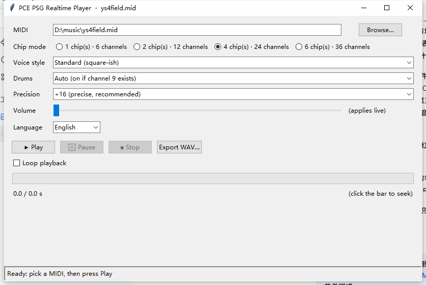

# PCE PSG Realtime Player

> **Language**: [English | [简体中文](README_zh.md)]

Realtime MIDI player for the **Hudson HuC6280 PSG** — the six-channel wavetable
sound block inside the PC Engine / TurboGrafx-16 — with a from-scratch behavioral
core, a tkinter GUI, a CLI, and a single-file Windows EXE.

Six channels is what one chip gives you — that part is the hardware. Playing a whole
MIDI file on six channels is brutal, so the player stacks up to six PSGs into a
6N-channel rack (24 voices by default) and drives them with a sample-accurate
register-write scheduler — the chip has no hardware envelope, so every ADSR step
*is* a register write. All percussion is synthesized: the EXE ships no sample data.

**License: MIT** (code) · `ref/c6280.cpp` is MAME's BSD-3-Clause reference
implementation, kept for behavioral cross-checking only — see [LICENSE](LICENSE)
and [NOTICE.md](NOTICE.md).



> **⬇️ Download**: the prebuilt single-file EXE is attached to the
> [**Releases**](../../releases) page (~25 MB, no Python required).
>
> The repository ships **source only** — `dist/` is gitignored on purpose. The EXE
> is fully reproducible with `build_exe.ps1`.

```
python app_pce.py                 # GUI
python render_midi.py song.mid    # offline MIDI → WAV
```

---

## Origin & scope

The project started as a handoff note about "can the PCE PSG be a MIDI synth", and
the realtime half is deliberately modeled on the author's **OPM Realtime Player**:
same idea of a sample-accurate renderer feeding a producer thread, same GUI
skeleton, same export-by-playing rule. The chip underneath is completely different —
and much cheaper to emulate.

| | OPM Realtime Player (sister project) | This repo |
|---|---|---|
| Chip | Yamaha YM2151 (FM) | Hudson HuC6280 PSG (wavetable) |
| Channels | 8 per chip | 6 per chip; rack of N (default 4 → 24) |
| Envelopes | in hardware (EG) | in software, one register write per step |
| Percussion | FM / SSG / PCM samples | swept-pitch kick + LFSR noise |
| Timing | sample-accurate event splitter | event splitter **+ register-write queue** |
| Relation | architecture donor | independent project |

## Features

| | |
|---|---|
| **Polyphony** | 6 per chip; 1 / 2 / 4 / 6 chips selectable → 6 / 12 / 24 / 36 voices |
| **Waveform** | 32-step × 5-bit wavetable, uploaded per program change |
| **Instruments** | 16 GM groups (`program // 8`), 3 voice styles |
| **Drums** | swept-pitch kick (200 → 55 Hz) + 18-bit LFSR noise |
| **Internal rate** | 223 721 Hz (PSG clock ÷ 16), resampled to 48 kHz |
| **Latency** | ≈ 43 ms buffer (8 × 256-frame blocks) |
| **Export** | WAV out through the *same* render chain as playback |
| **Loop / seek** | loop checkbox; click the progress bar to seek |
| **Realtime headroom** | one chip ≈ 84× realtime; 4-chip full pipeline ≈ 30× |
| **EXE** | single file, 24.6 MB, no installer, no Python |
| **UI languages** | Chinese / English, switchable at runtime |

---

## Quick start

### Prebuilt EXE

```
PCEPSG-RT.exe
```

Pick a MIDI file, choose a chip count, press Play. Settings persist in
`player_pce.json` next to the EXE. Run `PCEPSG-RT.exe --selfcheck` to write a
diagnostics log to `selfcheck.log`.

### From source

```powershell
git clone <this repo> PCEPSG-RT
cd PCEPSG-RT
python -m pip install -r requirements.txt
python app_pce.py
```

Requires Python 3.10+ (tested on 3.14.7). Only two dependencies: `numpy`,
`sounddevice`. The native core (`pcepsg.dll`) is prebuilt and included — **no
compiler needed** to run or to build the EXE.

### Build the EXE yourself

```powershell
python -m pip install pyinstaller
.\build_exe.ps1            # windowed
.\build_exe.ps1 -Console   # with a console, for troubleshooting
```

### Rebuild the native core (optional)

Only needed if you touch `core/pcepsg.c`:

```powershell
.\build_core.ps1           # gcc -O2 -shared; needs w64devkit or MinGW-w64
```

---

## Channels: one chip, or a rack

A PC Engine has exactly **one** HuC6280, so exactly **six** channels — that part is
non-negotiable history. But "six channels for a whole MIDI file" means constant
voice stealing: on a 614-note test excerpt, a single chip stole 446 times, which
is audible as notes cutting each other off.

So the player stacks N chips and mixes them. Each chip is still a byte-exact
six-channel PSG; the rack is just "N PC Engines playing the same arrangement".

| Chips | Channels | Melodic (drums on) | Measured cost | Typical use |
|---|---|---|---|---|
| 1 | 6 | 4 | 24 ms / audio-second | authentic mode |
| 2 | 12 | 10 | 31 ms / audio-second | classic game-style arranging |
| **4** | **24** | **22** | **33 ms / audio-second** | **default, ≈ GM-class polyphony** |
| 6 | 36 | 34 | 34 ms / audio-second | piano / orchestral |

The cost is almost flat in chip count: what actually costs time is *channels that are
sounding*. Idle chips hit an `enabled == 0` fast return, so on the same piece going
from 4 to 6 chips is only 3 % slower.

On the same excerpt, 4 chips bring that down to **4 steals**. Use `--chips 1` when
you want to hear what one machine could actually do.

## The chip (HuC6280 PSG)

Six channels, each with its own 32-step wavetable, 12-bit divider, 5-bit volume and
per-channel L/R balance. Noise on channels 4–5 only, direct D/A on channel 5 only.

| Address | Register |
|---|---|
| `$0800` | channel select (bits 0–2; 6–7 are empty slots) |
| `$0801` | master volume, bits 7–4 left / 3–0 right |
| `$0802` | frequency low 8 bits |
| `$0803` | frequency high 4 bits |
| `$0804` | bit 7 enable · bit 6 DDA · bits 0–4 volume |
| `$0805` | channel balance, bits 7–4 left / 3–0 right |
| `$0806` | wavetable data (auto-increments **only while the channel is off**) |
| `$0807` | noise: bit 7 enable · bits 0–4 frequency (inverted), ch 4/5 only |
| `$0808` | LFO frequency |
| `$0809` | LFO: bit 7 reset · bits 1–0 mode (only channels 0 and 1 take part) |

A few behaviors that are easy to get wrong, and that the core reproduces:

- **Pitch** is `f = 3 579 545 / (32 × F)`, where `F` is the 12-bit divider and
  `F = 0` means 4096. Pitch resolution therefore follows the divider: about
  ±3 cents at A4, coarser toward the top of the range.
- **Volume is not a multiplication.** Master, channel volume and balance each
  become an attenuation index through a 16-entry hardware table, then the three are
  *summed* and clamped to 31 (silence). One consequence: balance `0x88` is **not**
  centre — it attenuates each side by 22.5 dB. Centre is `0xFF`.
- **5-bit volume = 32 steps × 1.5 dB.** There is no finer resolution in the chip,
  which is why envelopes are stepped and phrasing is done by the driver.
- **The wavetable is 5-bit unsigned but the chip subtracts 16**, leaving a −0.5 LSB
  DC offset; every volume change would otherwise become a click. The core runs an
  8 Hz one-pole DC blocker on the output, standing in for the analog coupling cap.
- **The LFO only modulates channel 0**, using channel 1's wavetable as its source,
  and channel 1 stays audible.

## Voices & styles

GM programs are folded into 16 groups (`program // 8`) — six channels could never
carry 128 instruments.

| # | Group | Default wave | Character |
|---|---|---|---|
| 0 | piano | square | bright pluck, fast decay |
| 1 | chromatic | triangle | mellow, percussive |
| 2 | organ | organ | flat sustain, instant attack |
| 3 | guitar | saw | buzzy pluck |
| 4 | bass | bass | low harmonics, tight release |
| 5 | strings | saw | slow swell |
| 6 | ensemble | organ | slow pad |
| 7 | brass | lead | mid attack |
| 8 | reed | pulse 25 % | nasal |
| 9 | pipe | sine | pure, breathy attack |
| 10 | lead | square | immediately bright |
| 11 | pad | triangle | very slow |
| 12 | fx | hollow | odd harmonics |
| 13 | ethnic | pulse 12.5 % | thin, reedy |
| 14 | percussive | bell | no sustain |
| 15 | sfx | hollow | short |

Three **voice styles** re-map the wavetables without touching the envelopes, so you
can A/B the same arrangement in one click:

| Style | Waves |
|---|---|
| `standard` | as above |
| `soft` | sine / triangle everywhere (organ keeps its wave) |
| `bright` | square / pulse / saw everywhere |

## Drums

No samples ship, and none are needed — percussion is synthesized on chip 0's
channels 4 and 5, which are the only ones with noise:

| GM notes | Engine |
|---|---|
| 35 / 36 kick | wavetable channel, pitch swept 200 → 55 Hz over 90 ms, 190 ms decay |
| 38 / 40 snare | noise (18-bit LFSR), 110 ms decay |
| 42 / 44 / 46 closed hat | noise, 42 ms decay |
| 49 / 51 / 57 crash | noise, 900 ms decay |
| 37 / 39 rim / clap | noise, 90 ms decay |
| anything else | noise, 120 ms decay |

The kick's pitch envelope is written through the register-write queue at exact
sample frames — the same mechanism a real PCE driver would use.

## Export, loop, seek

**Export** renders through the *same* chain as playback — rack gain, master volume,
soft limiter and resampling all apply — so the WAV sounds exactly like what you
heard. It runs in a background thread with a progress bar and cancel.

```powershell
# GUI: click "Export WAV…"
python render_midi.py song.mid -o out.wav            # offline, auto-normalised
python render_midi.py song.mid --sec 30 --chips 1    # authentic single chip
```

`render_midi.py` is the standalone converter and additionally auto-normalises the
file to −1 dBFS; the GUI export deliberately does not, so it matches playback.

**Loop** restarts at the end of the song. Each pass rebuilds the chip and replays
program changes, CCs and pitch bends up to the start, then re-keys any note still
held — the PSG is a stateful chip, so a truly gapless loop would need a different
architecture.

**Seek** by clicking anywhere on the progress bar. Same rebuild-and-replay as the
loop, about 0.2 s.

## How it works

```
MIDI ── parse_smf ──► events (seconds)
                          │
                          ▼
                 PsgRenderer · sample-accurate splitter
                          │   split at min( next MIDI event,
                          │                  next queued register write,
                          ▼                  next envelope step )
                 PsgDriver · 6N voice allocation, software ADSR, drum routing
                          │   register writes at exact sample frames
                          ▼
                 N × PSG chip cores  (each 223 721 Hz, own 6 channels)
                          │   int32 sum × 1/√N, per-chip DC blocker
                          ▼
                 Resampler · 223 721 → 48 000 (4-point Catmull-Rom)
                          ▼
                 Producer thread ──► ring buffer ──► sounddevice callback
```

Key design points:

- **The write queue is the architecture, not an optimization.** With no hardware
  envelope, a 20 ms attack is roughly sixteen volume steps that must land at
  specific samples. The scheduler splits blocks at `min(MIDI event, queued write,
  next envelope step)`, so envelopes are sample-accurate rather than quantised to
  the audio block.
- **÷16, not ÷64.** At the "natural" 55 930 Hz (clock ÷ 64) a 1046 Hz note has a
  wavetable step rate of 33.5 kHz — past Nyquist. Measured: a −33 dB spur at f0/2.
  Running the core at 223 721 Hz and resampling fixes it (spur drops to −131 dB),
  for 4× the core cost, which is affordable.
- **Sum, then scale.** N chips are accumulated in int32 and scaled by 1/√N
  (uncorrelated sources), then limited. Idle chips take a fast path.
- **Wavetable upload is cached per (chip, channel)** and only happens on a program
  change, with the channel switched off so the write auto-increments.

## Measured performance

| Metric | Value |
|---|---|
| Single-chip core (÷16) | 11.9 ms per audio-second (≈ 84× realtime) |
| 4 chips, full pipeline on real MIDI | 33 ms per audio-second (≈ 30×) |
| Offline export, 4 chips | 58 ms per audio-second (≈ 17×) |
| Playback buffer | 8 × 256 frames ≈ 43 ms |
| Underruns in tests | 0 (3 × 8 s runs, frozen EXE, 4 chips) |
| EXE size | 24.6 MB |

The 43 ms buffer is not laziness: Windows' default timer granularity is 15.6 ms,
so a producer thread sleeping 2 ms really sleeps 15 ms. With a smaller buffer the
frozen build underran four times in four seconds; at 8 blocks it stays at zero.

## Repository layout

| File | Role |
|---|---|
| `app_pce.py` | tkinter GUI (zh/en), `--selfcheck`, `--play` |
| `pcepsg_session.py` | assembles rack + driver + engine + sound card; shared by GUI and export |
| `psg_sched.py` | register-write queue, sample-accurate renderer, resampler, producer thread |
| `psg_driver.py` | 6N voice allocation, software ADSR, drum routing |
| `pcepsg_core.py` | ctypes binding for the core and the multi-chip rack, pitch helpers |
| `pcew.py` | 32-step wavetables, 16 GM groups, 3 styles |
| `render_midi.py` | offline MIDI → WAV converter, built-in demo |
| `smf.py` | standard MIDI file parser |
| `core/pcepsg.c`, `core/pcepsg.h` | behavioral core + rack |
| `ref/c6280.cpp` | MAME reference implementation (BSD-3), not built |
| `tool/selftest.py` | 10 self-test groups |
| `tool/gui_smoke.py` | unattended GUI pass (play / pause / seek / language) |
| `build_core.ps1` / `build_exe.ps1` | build the DLL / the EXE |

## CLI reference

```
python render_midi.py song.mid [-o out.wav] [--chips N] [--div 16|64]
                               [--drums auto|on|off] [--sec S] [--tail S]
                               [--gain G] [--demo]

python app_pce.py [--lang zh|en] [--selfcheck]
                  [--play song.mid [--sec S] [--chips N]]
```

`--gain 0` (default) auto-normalises the offline render to −1 dBFS; pass an
explicit value to keep a fixed level.

## FAQ

**No sound?**
1. Make sure a MIDI file is selected — the status bar says "Ready" until you do.
2. Watch `underrun` in the time line. If it stays 0, audio is flowing: check the
   system volume or the output device.
3. Volume slider left at 0? It is saved between runs.

**`underrun` keeps climbing?**
Close other CPU-heavy programs first — the buffer is fixed at 8 × 256 frames. Lowering
the chip count only helps if the arrangement actually fills those extra channels.

**Dense passages drop notes?**
There are 6N physical channels. At the default 4 chips that is 24, of which drums
take 2 on chip 0, leaving 22 — enough for most GM files, but a piano-heavy piece
can still exceed it. Try `--chips 6`.

**High notes sound gritty?**
The wavetable has 32 steps, so its harmonic content keeps going past 24 kHz; the
final conversion to 48 kHz folds some of that back. This is the chip's own
character — the `--div 64` option makes it much worse, not better.

**Why four chips by default?**
Because six channels is the hardware, not the instrument. `--chips 1` gives you the
authentic six-channel experience; four gives you something that can actually play a
MIDI file without constant note-stealing.

**Antivirus flags the EXE?**
Common PyInstaller one-file false positive. Options: code-sign it, or switch
`build_exe.ps1` to `--onedir`.

## Testing

```powershell
python tool\selftest.py        # 10 groups, no sound card required
python tool\gui_smoke.py       # GUI: play → pause → resume → seek → language → stop
PCEPSG-RT.exe --selfcheck      # frozen-bundle diagnostics
```

The self-test covers: pitch accuracy against theory across dividers, divider
independence, byte-identical output across block sizes, register-write queue
sample accuracy, the volume table and DDA, noise spectrum, DC blocking, envelope
behavior, multi-chip isolation, and throughput.

## License

**MIT** — see [LICENSE](LICENSE). Third-party material keeps its own terms, listed
in [NOTICE.md](NOTICE.md):

- `ref/c6280.cpp` — MAME's `c6280` device, **BSD-3-Clause**, © Charles MacDonald
  and the MAME team. Used as a behavioral reference only; the core in
  `core/pcepsg.c` is an independent implementation and contains no MAME code.

## Credits

- **MAME** `src/devices/sound/c6280.cpp` — Charles MacDonald's Hudson PSG emulator,
  the authority on how this chip actually behaves
- The realtime engine architecture grew out of the author's **OPM Realtime Player**
- [w64devkit](https://github.com/skeeto/w64devkit) — the Windows gcc toolchain used
  to build `pcepsg.dll`
- Hudson Soft / NEC for the original hardware — no code or data from the consoles
  is included anywhere in this repository
