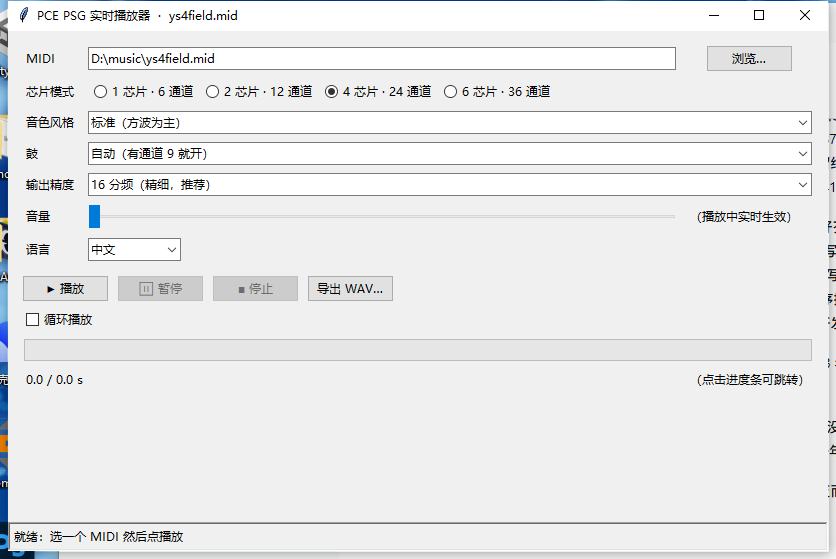

# PCE PSG 实时播放器

> **语言**：[[English](README.md) | 简体中文]

为 **Hudson HuC6280 PSG**（PC Engine / TurboGrafx-16 内部那块六通道波表音频模块）
打造的实时 MIDI 播放器——行为级核心从零重写，配 tkinter 图形界面、命令行，以及
单文件 Windows EXE。

一台 PCE 只有 6 个通道，这是硬件事实；但拿 6 个通道硬跑一整首 MIDI 太残酷，
所以播放器最多把 6 颗 PSG 叠成 6N 通道的"机架"（默认 24 复音），并用
**采样级寄存器写入队列**驱动它——芯片没有硬件包络，每一个 ADSR 台阶都必须是一次
寄存器写入。打击乐全部是合成的，EXE 里不带任何采样数据。

**许可证：MIT**（代码部分）。`ref/c6280.cpp` 是 MAME 以 BSD-3-Clause 发布的参考
实现，只用于行为核对、不参与编译——详见 [LICENSE](LICENSE) 与 [NOTICE.md](NOTICE.md)。



> **⬇️ 下载**：打包好的单文件 EXE 挂在 [**Releases**](../../releases) 页
> （约 25 MB，无需 Python）。
>
> 仓库里**只放源码**——`dist/` 是故意 gitignore 掉的。EXE 用 `build_exe.ps1`
> 可以完整复现。

```
python app_pce.py                 # 图形界面
python render_midi.py song.mid    # 离线 MIDI → WAV
```

---

## 由来与定位

项目起点是一份"PCE 的 PSG 能不能做 MIDI 合成器"的交接笔记，实时部分刻意照着
作者的 **OPM 实时播放器** 来做：同样是采样级渲染器喂生产者线程，同一套 GUI 骨架，
同一条"导出即所听"的规则。底下的芯片完全不同，而且便宜得多。

| | OPM 实时播放器（姐妹项目） | 本仓库 |
|---|---|---|
| 芯片 | Yamaha YM2151 (FM) | Hudson HuC6280 PSG（波表） |
| 通道 | 每颗 8 | 每颗 6；机架 N 颗（默认 4 → 24） |
| 包络 | 硬件 EG | 软件，一步一次寄存器写入 |
| 打击乐 | FM / SSG / PCM 采样 | 扫频底鼓 + LFSR 噪声 |
| 调度 | 采样级事件切分 | 事件切分 **+ 寄存器写入队列** |
| 关系 | 架构供体 | 独立项目 |

## 特性

| | |
|---|---|
| **复音** | 每颗 6；可选 1 / 2 / 4 / 6 颗 → 6 / 12 / 24 / 36 通道 |
| **波形** | 32 步 × 5 bit 波表，按 program change 上传 |
| **音色** | 16 个 GM 乐器组（`program // 8`），3 种音色风格 |
| **鼓** | 扫频底鼓（200 → 55 Hz）+ 18-bit LFSR 噪声 |
| **内部采样率** | 223 721 Hz（PSG 时钟 ÷ 16），重采样到 48 kHz |
| **延迟** | 约 43 ms 缓冲（8 × 256 帧） |
| **导出** | 走**同一条**渲染链输出 WAV |
| **循环 / 跳转** | 界面勾选框循环；点进度条跳转 |
| **实时余量** | 单芯片约 84 倍实时；4 芯片全链路约 30 倍 |
| **EXE** | 单文件 24.6 MB，无需安装、无需 Python |
| **界面语言** | 中文 / English，运行时可切换 |

---

## 快速开始

### 现成 EXE

```
PCEPSG-RT.exe
```

选一个 MIDI、选芯片数，点播放。设置会存在 EXE 旁边的 `player_pce.json`。
执行 `PCEPSG-RT.exe --selfcheck` 会把诊断信息写进 `selfcheck.log`。

### 从源码运行

```powershell
git clone <本仓库> PCEPSG-RT
cd PCEPSG-RT
python -m pip install -r requirements.txt
python app_pce.py
```

需要 Python 3.10+（实测 3.14.7）。依赖只有两个：`numpy`、`sounddevice`。
原生核心（`pcepsg.dll`）已预编译随仓库提供，**运行和打包都不需要编译器**。

### 自己打包 EXE

```powershell
python -m pip install pyinstaller
.\build_exe.ps1            # 窗口版
.\build_exe.ps1 -Console   # 带控制台，排错用
```

### 重编原生核心（可选）

只有改 `core/pcepsg.c` 时才需要：

```powershell
.\build_core.ps1           # gcc -O2 -shared；需要 w64devkit 或 MinGW-w64
```

---

## 通道数：一颗芯片，还是一副机架

一台 PC Engine 上确实只有**一颗** HuC6280，也就是**六个**通道——这部分没得商量。
但"六个通道跑一首 MIDI"意味着无休止的抢音：一段 614 个音符的测试片段，单芯片抢了
446 次，听感就是音符互相掐断。

所以播放器把 N 颗芯片叠起来混音。每颗芯片内部仍然是逐字节精确的六通道 PSG，
机架无非是"N 台 PCE 演奏同一份编曲"。

| 芯片 | 通道 | 旋律（开鼓） | 实测成本 | 适用 |
|---|---|---|---|---|
| 1 | 6 | 4 | 24 ms / 音频秒 | 历史模式 |
| 2 | 12 | 10 | 31 ms / 音频秒 | 老游戏风编曲 |
| **4** | **24** | **22** | **33 ms / 音频秒** | **默认，约 GM 级复音** |
| 6 | 36 | 34 | 34 ms / 音频秒 | 钢琴 / 管弦乐 |

有意思的是成本几乎不随芯片数线性涨：真正花钱的是**正在发声的通道**，空闲芯片走
`enabled == 0` 的快速返回路径。同一首曲子上到 6 芯片只比 4 芯片贵 3%。

同一段片段上到 4 芯片，抢音降到 **4 次**。想听"一台机器能做出什么"，就跑
`--chips 1`。

## 芯片（HuC6280 PSG）

六通道，每通道独立：32 步波表、12-bit 分频、5-bit 音量、左右平衡。噪声只有
通道 4/5 有，DDA 只有通道 5 有。

| 地址 | 寄存器 |
|---|---|
| `$0800` | 通道选择（bit 0–2；6–7 是空槽） |
| `$0801` | 主音量，bit 7–4 左 / 3–0 右 |
| `$0802` | 分频低 8 位 |
| `$0803` | 分频高 4 位 |
| `$0804` | bit 7 使能 · bit 6 DDA · bit 0–4 音量 |
| `$0805` | 通道平衡，bit 7–4 左 / 3–0 右 |
| `$0806` | 波表数据（**只在通道关闭时**自动递增） |
| `$0807` | 噪声：bit 7 使能 · bit 0–4 频率（取反），仅通道 4/5 |
| `$0808` | LFO 频率 |
| `$0809` | LFO：bit 7 复位 · bit 1–0 模式（只涉及通道 0 和 1） |

几个特别容易写错、而核心里都按真机复刻了的点：

- **音高**是 `f = 3 579 545 / (32 × F)`，`F` 是 12-bit 分频值，`F = 0` 当 4096。
  所以音准精度跟着分频值走：A4 附近约 ±3 音分，越往高音区越粗。
- **音量不是相乘**。主音量、通道音量、平衡各自先过一张 16 项硬件表变成衰减指数，
  然后三者**相加**、钳到 31（静音）。有个直接后果：平衡写 `0x88` **不是居中**，
  而是每边衰减 22.5 dB；居中得写 `0xFF`。
- **5-bit 音量 = 32 档 × 1.5 dB**。芯片里没有更细的分辨率，所以包络是一级一级
  踩上去的，修饰全靠驱动。
- **波表是 5-bit 无符号、但芯片会减 16**，于是天然残留 −0.5 LSB 直流；不做处理的话
  每次音量变化都会变成一次咔哒。核心在输出端挂了 8 Hz 一阶隔直，模拟真机的耦合电容。
- **LFO 只调变通道 0**，波形源是通道 1 的波表，而且通道 1 不会被静音。

## 音色与风格

GM 的 program 被折叠成 16 个乐器组（`program // 8`）——六个通道本来也装不下 128 个音色。

| # | 乐器组 | 默认波形 | 性格 |
|---|---|---|---|
| 0 | 钢琴 | 方波 | 亮、衰减快 |
| 1 | 半音阶 | 三角 | 柔和、颗粒 |
| 2 | 风琴 | 风琴波 | 平直延续，起音瞬发 |
| 3 | 吉他 | 锯齿 | 带毛刺的拨弦 |
| 4 | 贝斯 | 贝斯波 | 低次谐波，收得快 |
| 5 | 弦乐 | 锯齿 | 慢起 |
| 6 | 合奏 | 风琴波 | 慢铺底 |
| 7 | 铜管 | 主音波 | 中等起音 |
| 8 | 簧管 | 25% 脉冲 | 鼻音 |
| 9 | 管乐 | 正弦 | 纯净，带气声起音 |
| 10 | 主音 | 方波 | 一上来就亮 |
| 11 | 铺底 | 三角 | 非常慢 |
| 12 | 音效 | 空芯波 | 奇次谐波 |
| 13 | 民族 | 12.5% 脉冲 | 细、簧片味 |
| 14 | 打击 | 钟 | 无延音 |
| 15 | 音效 | 空芯波 | 短促 |

三组**音色风格**只换波表、不动包络，方便一键 A/B 同一份编曲：

| 风格 | 波形 |
|---|---|
| `standard` | 如上表 |
| `soft` | 全面换成正弦 / 三角（风琴保留原波） |
| `bright` | 全面换成方波 / 脉冲 / 锯齿 |

## 鼓

不带任何采样，也不需要——打击乐用芯片 0 的通道 4 和 5 合成，因为只有它们有噪声：

| GM 音符 | 引擎 |
|---|---|
| 35 / 36 底鼓 | 波表通道，音高 90 ms 内从 200 Hz 扫到 55 Hz，190 ms 衰减 |
| 38 / 40 军鼓 | 噪声（18-bit LFSR），110 ms 衰减 |
| 42 / 44 / 46 闭镲 | 噪声，42 ms 衰减 |
| 49 / 51 / 57 强音镲 | 噪声，900 ms 衰减 |
| 37 / 39 边击 / 拍手 | 噪声，90 ms 衰减 |
| 其余 | 噪声，120 ms 衰减 |

底鼓的音高包络是通过寄存器写入队列在精确采样点上落下去的——真机驱动也是这么干的。

## 导出、循环、跳转

**导出**走的是**和播放完全相同**的渲染链——机架增益、总音量、软限幅、重采样全都
一致，所以导出的 WAV 和你听到的一模一样。渲染在后台线程里跑，带进度条和取消。

```powershell
# 界面：点「导出 WAV…」
python render_midi.py song.mid -o out.wav            # 离线转换，自动归一化
python render_midi.py song.mid --sec 30 --chips 1    # 历史单芯片对照
```

`render_midi.py` 是独立的离线转换器，会额外把结果归一到 −1 dBFS；界面的导出
故意不归一化，这样它才和播放一致。

**循环**在曲子播完后从头再来。每一轮都会重建芯片，并重放音色切换 / CC / 弯音到
起点，再把仍按住的音重新起音——PSG 是有状态芯片，想要真正无缝的循环需要换一套
渲染架构（整曲预渲染）。

**跳转**：点进度条任意位置即可。和循环一样是"重建 + 重放"，约 0.2 秒。

## 工作原理

```
MIDI ── parse_smf ──► 事件表（秒）
                          │
                          ▼
                 PsgRenderer · 采样级切分
                          │   按 min( 下一条 MIDI 事件,
                          │          队列里下一次寄存器写入,
                          ▼          驱动的下一次包络台阶 ) 切块
                 PsgDriver · 6N 声部分配、软件 ADSR、鼓路由
                          │   在精确采样帧上写寄存器
                          ▼
                 N 颗 PSG 核心（各自 223 721 Hz、6 个通道）
                          │   int32 累加 × 1/√N，每颗芯片各自隔直
                          ▼
                 重采样 · 223 721 → 48 000（4 点 Catmull-Rom）
                          ▼
                 生产者线程 ──► 环形缓冲 ──► sounddevice 回调
```

几个关键点：

- **写入队列是架构，不是优化。** 没有硬件包络，一个 20 ms 的 attack 就是十几个
  音量台阶，必须落在指定采样点上。调度器按 `min(MIDI 事件, 队列写入, 下一次包络
  台阶)` 切块，所以包络是采样级精确的，而不是被量化到音频块。
- **÷16 而不是 ÷64。** 用"自然"的 55 930 Hz（时钟 ÷ 64）时，1046 Hz 的音其波表
  步进速率已是 33.5 kHz，超过奈奎斯特；实测 f0/2 处出现 −33 dB 寄生音。把核心跑到
  223 721 Hz 再重采样就干净了（寄生音降到 −131 dB），代价是 4 倍核心开销——付得起。
- **先累加再缩放。** N 颗芯片用 int32 相加，乘 1/√N（非相干叠加），再限幅。
  空闲芯片走快速返回路径。
- **波表上传按 (芯片, 通道) 缓存**，只在 program change 时做，而且必须先把通道关掉
  ——只有这样写入才会自动递增。

## 实测性能

| 指标 | 数值 |
|---|---|
| 单芯片核心（÷16） | 11.9 ms / 音频秒（约 84 倍实时） |
| 4 芯片全链路，真实 MIDI | 33 ms / 音频秒（约 30 倍） |
| 离线导出，4 芯片 | 58 ms / 音频秒（约 17 倍） |
| 播放缓冲 | 8 × 256 帧 ≈ 43 ms |
| 测试中的 underrun | 0（冻结 EXE，4 芯片，连续 3 次 × 8 秒） |
| EXE 体积 | 24.6 MB |

43 ms 缓冲不是为了保险：Windows 默认定时器粒度是 15.6 ms，生产者线程 `sleep(2ms)`
实际会睡 15 ms。缓冲更小时，冻结版实测 4 秒内欠载 4 次；加到 8 块后归零。

## 目录结构

| 文件 | 作用 |
|---|---|
| `app_pce.py` | tkinter 图形界面（中/英）、`--selfcheck`、`--play` |
| `pcepsg_session.py` | 组装机架 + 驱动 + 引擎 + 声卡；GUI 与导出共用 |
| `psg_sched.py` | 寄存器写入队列、采样级渲染器、重采样、生产者线程 |
| `psg_driver.py` | 6N 声部分配、软件 ADSR、鼓路由 |
| `pcepsg_core.py` | 核心与多芯片机架的 ctypes 绑定、音高换算 |
| `pcew.py` | 32 步波表、16 个 GM 乐器组、3 种风格 |
| `render_midi.py` | 离线 MIDI → WAV 转换器，含内置 demo |
| `smf.py` | 标准 MIDI 文件解析 |
| `core/pcepsg.c`、`core/pcepsg.h` | 行为级核心 + 机架 |
| `ref/c6280.cpp` | MAME 参考实现（BSD-3），不参与编译 |
| `tool/selftest.py` | 10 组自检 |
| `tool/gui_smoke.py` | 无人值守跑一遍 GUI（播放/暂停/跳转/语言） |
| `build_core.ps1` / `build_exe.ps1` | 编 DLL / 打包 EXE |

## 命令行

```
python render_midi.py song.mid [-o out.wav] [--chips N] [--div 16|64]
                               [--drums auto|on|off] [--sec S] [--tail S]
                               [--gain G] [--demo]

python app_pce.py [--lang zh|en] [--selfcheck]
                  [--play song.mid [--sec S] [--chips N]]
```

`--gain 0`（默认）会把离线渲染自动归一到 −1 dBFS；想固定电平就传具体数值。

## 常见问题

**播放没声音？**
1. 先确认选了 MIDI 文件——没选时状态栏一直显示"就绪"。
2. 看时间那行的 `underrun`：一直为 0 说明音频在正常输出，问题在系统音量或输出设备。
3. 音量滑块是不是留在 0？它是会被记住的。

**`underrun` 一直涨？**
先关掉别的吃 CPU 的程序——缓冲固定 8 × 256 帧。降芯片数只在编曲真的用满了那些
通道时才有帮助。

**复杂段落丢音？**
物理通道是 6N。默认 4 芯片 = 24，其中鼓占芯片 0 的 2 个，剩 22 个——大多数 GM
文件够用，但钢琴独奏那种密集织体还是会超。可以试 `--chips 6`。

**高音有点毛？**
波表只有 32 步，谐波会一直延伸到 24 kHz 以上，最后转成 48 kHz 时会折返一部分。
这是芯片本身的性格——`--div 64` 只会更糟，不会更好。

**为什么默认四颗芯片？**
因为六个通道是硬件，不是乐器。`--chips 1` 给你真实的六通道体验；四颗才够正常
播放一首 MIDI 而不一直抢音。

**EXE 被杀软报毒？**
PyInstaller 单文件的常见误报。可选：加数字签名，或把 `build_exe.ps1` 改成 `--onedir`。

## 测试

```powershell
python tool\selftest.py        # 10 组，不需要声卡
python tool\gui_smoke.py       # GUI：播放 → 暂停 → 继续 → 跳转 → 语言 → 停止
PCEPSG-RT.exe --selfcheck      # 冻结包诊断
```

自检覆盖：不同分频下音高对比理论值、分频系数无关性、块大小变化下逐字节一致、
寄存器写入队列的采样级精确性、音量表与 DDA、噪声频谱、隔直、包络行为、
多芯片互不干扰、吞吐。

## 许可

**MIT** —— 见 [LICENSE](LICENSE)。第三方材料遵循各自的条款，见 [NOTICE.md](NOTICE.md)：

- `ref/c6280.cpp` —— MAME 的 `c6280` 设备，**BSD-3-Clause**，© Charles MacDonald
  与 MAME 团队。仅作行为参考；`core/pcepsg.c` 是独立实现，不含任何 MAME 代码。

## 致谢

- **MAME** `src/devices/sound/c6280.cpp` —— Charles MacDonald 的 Hudson PSG
  模拟器，这颗芯片到底怎么行为的权威依据
- 实时引擎的架构脱胎于作者的 **OPM 实时播放器**
- [w64devkit](https://github.com/skeeto/w64devkit) —— 编译 `pcepsg.dll` 用的
  Windows gcc 工具链
- Hudson Soft / NEC 的原版硬件——本仓库不包含任何来自主机的代码或数据
